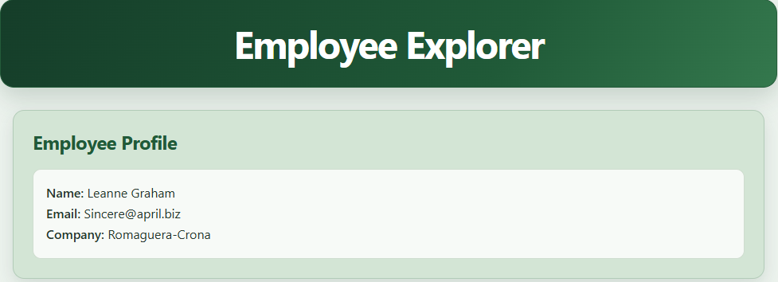
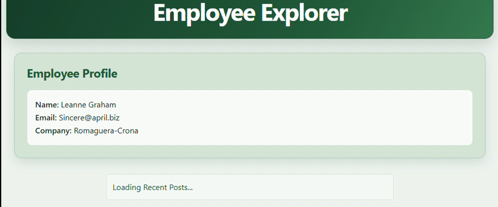
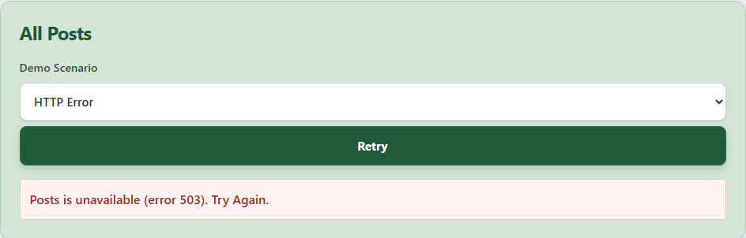
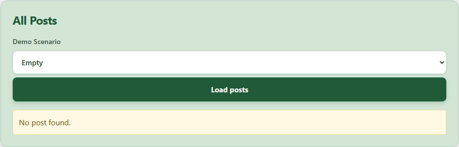

# Testing

|#|Check|Expected Result|Actual Result|Pass/Fail
|---|---|---|---|---|
|1|Server Profile|Name,Email,Company of employee1|As Expected|Pass|
|2|Server Preview|fallback-2s+visible title|As Expected,Title+"Loading Employees"|Pass|
|3|Client Idle|No request before click|As Expected|Pass|
|4|Client Slow|Loading shown+button disabled|As Expected|Pass|
|5|Client Success|Titles and bodies appear|As Expected|Pass|
|6|HTTP Failure|Red error message+Retry button|As Expected|Pass|
|7|Empty Response|"No post found"|As Expected|Pass|
|8|Recovery|Success+Retry then shows posts|As Expected|Pass|
|9|Section Independence|Profile and preview stay visible|As Expected|Pass|
|10|Usability|Labels,focus,readable at 360px|As Expected|Pass|

## Commands

|Command|Actual Result|
|---|---|
|npm run lint|Completed with 0 errors and 1 warning(at rule @theme in global.css, from Tailwind syntax, not a code error)|
| npm run build | Completed successfully. Static pages generated (4/4), no errors. Route `/` shown as Partial Prerender, `/_not-found` as Static. |

## Screenshots

### Normal State

### Server Preview Loading

### Client Error

### Empty State

## Not Tested
None. All 10 checks.